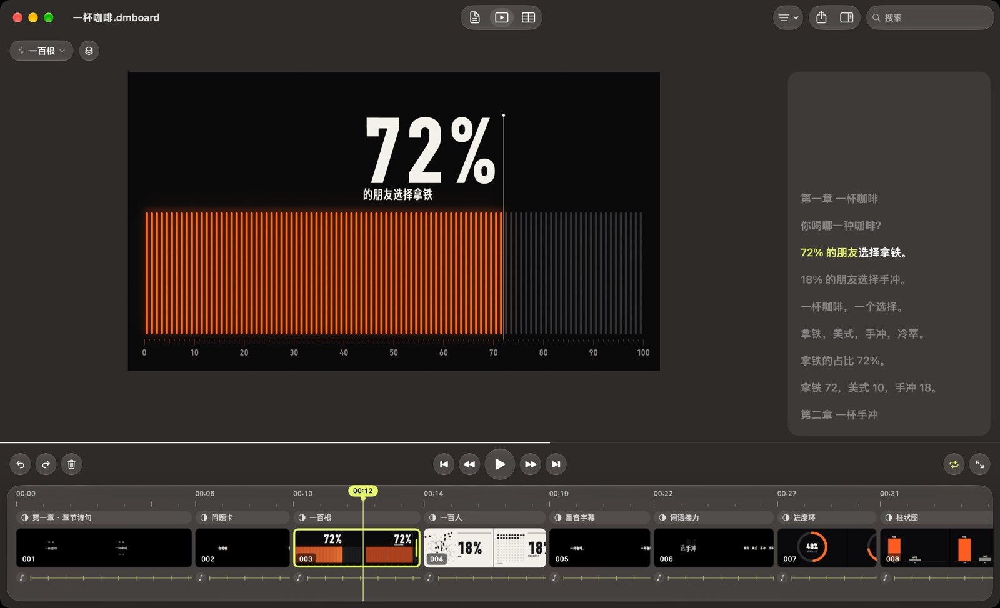

<p align="center"></p>

<h1 align="center">肉呆爱动效</h1>

<p align="center">口播文稿变动效视频。导入文稿或 A-roll，生成分镜，拖片段，换效果，导出 MP4。</p>

<p align="center"><b><a href="https://github.com/rddmwmddr/roudai-aidongxiao/releases/latest/download/RouDaiAiDongXiao.dmg">下载 dmg</a></b> · <a href="https://ahuamiao.com/sites/other/roudai-tools.html#motion">官网和图文教程</a></p>

<p align="center">macOS 13 及以上 · A-roll 识别：macOS 26 及以上 · Apple 芯片和 Intel 通用 · Apple 公证</p>



截图里是示例文稿，数字是示例。

## 特点

### 动效库

733 个动效，11 个分类：百分比 11、图表 55、细读图表 39、文字 26、文字特效 130、状态 64、交互 58、质感 54、加载 99、按钮 101、开关提示 96。

**特点**

- 文稿匹配动效：百分比进一百根、一百人，一串数进图表，短句进文字特效。
- 成片的字和数字来自文稿。默认字和默认数：样例专用。样例镜头：导出跳过。
- 挑选窗口带预览：左侧分类，上方预览，下方效果。

**好处**：一句「72% 的朋友选择拿铁」配一百根竖条，72 根亮起，数字和文稿一致。

### 脚本框和时间线

画面右侧是脚本框，下方是时间线，两边联动。

**特点**

- 点片段：脚本框跳到这一句，高亮这一句，播放进度带着字走。
- 点句子：时间线跳到这一镜。
- 脚本框回车：拆成两镜。时间线 B 键：拆在播放头。
- 选中几句或 ⌘ 点几个片段，右键：组合、重新匹配、导出。
- 拖片段右边缘：改时长，整段动画跟着变。右拖放慢，左拖加快。右栏「速率」：2 是两倍快。
- 点片段上方的胶囊：换效果。
- 右栏「颜色」：组件、CSS 动效、数据动效的底色、主色、辅色、文字色，点色块选色，右键恢复默认。

**好处**：长段落：回车，两段两个动效。几句话讲同一组数：组合，两个数进同一张图。

### 文稿

**特点**

- 打开软件：示例分镜开始播放，画面、脚本框、时间线一屏看全。<kbd>⌘</kbd><kbd>N</kbd>：新建空白文稿。
- 文稿格式：Word、WPS、Pages、PPT、Keynote、Excel、Numbers、PDF、epub、网页、字幕、纯文本、图片。扫描版 PDF 和图片：文字识别。
- 看文件内容判断格式，改过扩展名的文件同样能读。

**好处**：手里的稿子是什么格式，导入什么格式。

### A-roll

**特点**

- 导入视频或音频，离线识别，一句一镜，时长对齐声音，动效配好。
- 现成的分镜：字和效果保留，时长对齐声音。
- 系统要求：macOS 26 及以上。

**好处**：录完口播，导入视频。时间线和声音对齐。

### 导出

**特点**

- MP4，4K、1080p，60 帧、30 帧。
- 一镜一个文件。批量导出：跳过现成的文件，写一份输出清单。

**好处**：一镜一条素材，进剪辑软件，时长和口播一致。

## 教程

[官网教程](https://ahuamiao.com/sites/other/roudai-tools.html#m-tutorial)：十一步，一步一张图。

## 源码构建

需要 Xcode、[XcodeGen](https://github.com/yonaskolb/XcodeGen)、Python 3。测试需要 Node 和 Chrome。

```bash
python3 tools/build.py        # 打包引擎，生成单文件网页版 dist/肉呆爱动效.html
cd mac && xcodegen generate   # 生成 Xcode 工程
tools/check.sh                # 打包、界面规则、引擎测试、原生单元测试
```

公证发版：

```bash
SIGN_ID="Developer ID Application: 名字 (TEAMID)" TEAM=TEAMID NOTARY_PROFILE=钥匙串配置名 tools/build_app.sh
```

## AI 和 Key

规则模式：离线，零 Key。AI 模式：填你自己的服务和 Key，Key 存进本机钥匙串。安装包和仓库：零 Key。

## 授权

| 来源 | 用途 | 授权 |
|---|---|---|
| [Motion Prompt](https://github.com/showheyohtaki/motion-prompt) | 14 个文字动效 | MIT |
| [Colorion](https://colorion.co/) | 417 个 CSS 动效 | MIT |
| [Lieflat Charts](https://github.com/larashero3-dotcom/lieflat-charts) | 39 种细读图表 | PolyForm Noncommercial |
| [mp4-muxer](https://github.com/Vanilagy/mp4-muxer) | 写 MP4 文件 | MIT |
| [寒蝉德黑体 / ChillDIN](https://github.com/Warren2060/ChillDIN-ChillDINGothic) | 字体 | OFL |
| [Kinetics](https://kinetics.colorion.co/) | 162 个界面组件的效果清单。代码自写 | 参考 |
| [Verse Text](https://verse.rajatsethii.in/) | 错位印刷的效果。代码自写 | 参考 |
| [uiarc / arc-library](https://github.com/kuratlielia/arc-library) | 30 个组件的效果和动效参数。代码自写 | MIT |

Lieflat Charts 的条款限定非商业用途。商用视频：选其余 694 种动效，或购买作者的授权。

授权原文：`vendor/`、`fonts/`、`mac/Resources/licenses/`。App 的「关于」页列出全部来源。
